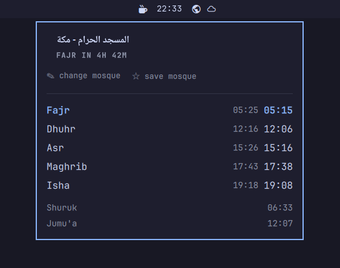

# Mawaqit Prayer Times

An unofficial [Omarchy](https://omarchy.org) bar plugin that shows the five daily prayer
times for a mosque of your choosing, pulled from its [mawaqit.net](https://mawaqit.net)
page. Prayer time lookup runs through a small bundled Python script; the QML
side only handles display, countdown, and settings.

The bar pill shows the next prayer and its time (e.g. `Asr 16:43`). Click it
to open a panel with all five prayers, shuruk, and Jumu'a, with the next
prayer highlighted.



## Install

```
omarchy plugin add https://github.com/zaka53/omarchy-mawaqit-times.git --enable
```

Or clone it into `~/.config/omarchy/plugins/` yourself and enable it from
_Setup > Plugins_.

## Configure

Click the bar pill to open the panel, then click "change mosque" (or just
enter one straight away if none is configured yet) and paste either:

- a mosque slug, e.g. `al-haram-makkah-saudi-arabia`, or
- a full mawaqit.net link, e.g. `https://mawaqit.net/en/al-haram-makkah-saudi-arabia`

Find your mosque's slug by searching for it at [mawaqit.net](https://mawaqit.net)
and copying the last part of its URL. Press Enter to save; Escape cancels.

To switch between several mosques quickly, click "☆ save mosque" while a
mosque is shown. Saved mosques are listed in the panel: click one to switch
to it, or × to remove it (up to 20 can be saved).

The choice and the saved list are stored in
`~/.local/state/omarchy/settings/mawaqit-times.json`.

## How it works

`scripts/mawaqit_times.py` fetches the mosque's public mawaqit.net page and
reads the `confData` JSON object embedded in it (the same data the page
itself renders from — there's no official public API for this). It prints a
small JSON summary to stdout: the mosque name, timezone, the five prayer
times, shuruk, and Jumu'a. The QML panel works out which prayer is next
locally, so the bar pill keeps updating without re-running the script.

### Network access

The plugin only ever contacts `https://mawaqit.net`, and only at these times:

- when you open the panel and today's times haven't been fetched yet (so at
  most once a day, cached in the settings file above),
- when you set or switch to a mosque,
- when you middle-click the bar pill (or call its `refresh` IPC target) to
  force a refresh.

There is no background polling: if the panel isn't opened, nothing is
fetched. Requests use HTTPS with a 10 second timeout, read at most 5 MiB,
and refuse redirects to any other host. Everything taken from the page is
validated and shown as plain text.

Requires `python3` (no extra Python packages) and a mosque that has a public
mawaqit.net page.

## License

MIT
